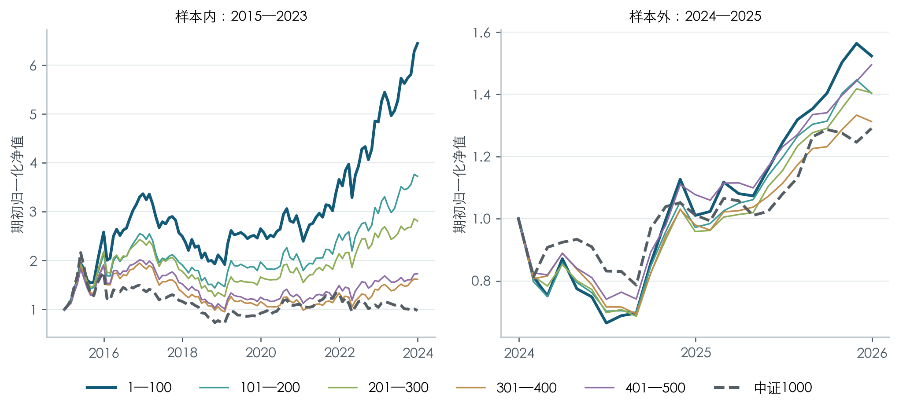

# A股小市值策略的收益延续性与执行约束

**最小市值组在历史留出期的收益点估计领先，但收益优势伴随较大回撤、ST退出障碍和资金约束。** 本项目用固定规则选组、对照实验及不确定性分析，区分“历史表现较好”与“已证明稳健有效”。

[项目网页](https://elysiaivy.github.io/a-share-microcap-research/) · [完整PDF](docs/research_report.pdf) · [Word报告](docs/research_report.docx) · [可运行Notebook](research.ipynb) · [运行说明](RUN_GUIDE.md)



## 研究设计

- **股票池与排名：**历史沪深主板，含原中小板和后来退市股票；排除金融、CDR、上市不足252个交易日、当时已知ST/退市整理及风险状态未知的股票。每月末按当时**总市值升序**排列，等值按代码排序；名次是过滤后的排名。
- **组合：**1—100、101—200、201—300、301—400、401—500名，月度目标等权。持仓出现已知风险时按规则退出；卖出款最早下一交易日按月初冻结候选顺延补仓，受停牌、限价及现金约束。
- **选优：**五档全部参与2015—2023年选优；单边30bp成本后月收益年化夏普最高者获选，无风险率0。并列先低换手，再较大市值区间。
- **验证：**冻结赢家后评价2024—2025年。该历史留出期曾在研究迭代中查看，**不是未窥视、完全独立的样本外**。

## 核心结果

| 单边30bp | 2015—2023年化收益 | 2015—2023夏普 | 2024—2025年化收益 | 2024—2025夏普 | 2024—2025日度最大回撤 |
|---|---:|---:|---:|---:|---:|
| 冻结赢家 1—100名 | 22.99% | 0.880 | 23.42% | 0.784 | -45.16% |
| 中证1000价格指数 | — | — | 13.58% | 0.595 | -27.08% |

收益为复合年化；夏普使用月收益样本标准差。指数没有扣除ETF费用，也不含分红，与股票复权收益口径不同。

**必须一起读的反面结果：**

- 赢家相对中证1000的平均月收益差为0.864个百分点，HAC(6) 95%区间为[-1.452, 3.180]个百分点，包含0。
- 历史留出期夏普最高的是401—500名，市值与收益不是严格单调关系。
- 最小组样本外ST规则对照的最大回撤均约45%；识别风险不代表能及时卖出。
- 2024—2025年最强5个月贡献超过全部累计对数收益。将这5个月置零后年化为-13.74%；这是事后诊断，不能交易。
- 100万元整手＋最低佣金情景年化22.00%、平均现金5.04%；应与**同起点现金建仓**的连续份额22.88%比较，不能直接与承接旧持仓的23.42%比较。资金实验未检验容量和冲击成本。

## 如何阅读代码

| 入口 | 用途 |
|---|---|
| [research.ipynb](research.ipynb) | 无需API，从公开表复算选优、绩效、HAC与主要图表 |
| [microcap/execution.py](microcap/execution.py) | 前收盘计划、次开盘成交、现金预算、ST退出和递延补仓 |
| [microcap/portfolio.py](microcap/portfolio.py) | 排名、组合与仅使用训练期的冻结选优 |
| [microcap/analysis.py](microcap/analysis.py) | 绩效、HAC及同样本控制回归 |
| [tests](tests) | 未来数据不改变训练选择、停牌/限价、资金与缺失值等检查 |
| [DATA_CONTRACT.md](DATA_CONTRACT.md) | 时点、交易、成本和缺失数据口径 |

## 快速复算

建议Python 3.13；安装版本固定的依赖后运行：

```bash
python -m venv .venv
source .venv/bin/activate  # Windows: .venv\Scripts\activate
python -m pip install -r requirements.txt
python scripts/verify_public.py --manifest
python -m unittest discover -s tests
python scripts/execute_notebook.py
```

这是**公开结果复算**，不是从原始行情重跑全部交易。完整回测需要未随包提供的授权数据、历史状态证据和逐笔模拟明细；缺失时程序会明确报错。详见[运行说明](RUN_GUIDE.md)。

## 研究边界与使用范围

历史财报版本尚未全部认证；早期停牌市值有估计补全，退市残值为情景假设。日线开盘成交未建模队列和容量。亏损、ST及控制后的剩余差异均不能证明壳价值或因果关系。

项目聚焦最终研究及相关反面证据；未参与最终策略的择时探索不在此仓库。未公开Tushare原始行情或凭据。代码未另行授予宽泛开源许可；第三方数据的使用与再分发须遵守各自授权。
