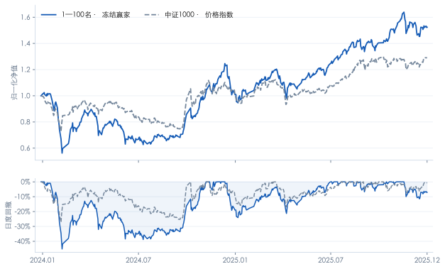
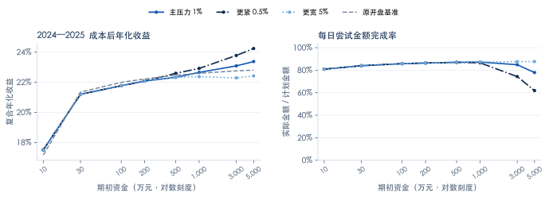

# A股小市值策略的收益延续性与执行约束

**按总市值选最小的100只股票，历史上能否盈利，交易约束会怎样改变收益？** 本项目用2015—2023年选组，固定赢家后评价2024—2025年，并检验ST退出、整手交易、最低佣金、成交容量与额外市场冲击的影响。

[项目网页](https://elysiaivy.github.io/a-share-microcap-research/) · [完整PDF](docs/research_report.pdf) · [Word报告](docs/research_report.docx) · [可运行Notebook](research.ipynb) · [运行说明](RUN_GUIDE.md)

## 1. 历史收益：盈利，但承受了较大回撤

**2015—2023年，1—100名组以成本后夏普0.880成为五档中的冻结赢家；2024—2025年仍取得正收益。**

| 2024—2025历史留出期 | 复合年化收益 | 月收益年化夏普 | 日度最大回撤 |
|---|---:|---:|---:|
| 冻结赢家：1—100名，单边30bp | **23.42%** | **0.784** | **-45.16%** |
| 中证1000价格指数 | 13.58% | 0.595 | -27.08% |

夏普使用月收益样本标准差、无风险率0。指数不含分红、未扣ETF实施费用，与股票复权收益口径有差异。2024—2025年的结果曾在研究迭代中查看，属于**历史留出评价，不能称为未窥视、完全独立验证**。



## 2. 执行可行性：从整手偏差，到日频成交压力

执行引擎考虑前收盘计划、次开盘成交、停牌、涨跌停、现金预算，以及风险退出后最早次交易日补仓。资金实验再加入100股整手和每笔最低5元佣金：

| 2024—2025，期初现金建仓 | 复合年化收益 | 平均现金占比 | 日度最大回撤 |
|---|---:|---:|---:|
| 连续份额对照 | 22.88% | 1.22% | -45.46% |
| 10万元：整手＋最低佣金 | 17.17% | 45.58% | -22.35% |
| 100万元：整手＋最低佣金 | 22.00% | 5.04% | -43.34% |

小资金难以接近100只股票的等权目标，现金闲置明显；资金增加后实现偏差缩小。100万元情景应与**同起点现金建仓的22.88%**比较，不能直接与承接旧持仓的23.42%比较。

最低佣金情景按单边“27.5bp综合项＋max(2.5bp佣金，5元)”计算，是研究假设。在此基础上，新增**日频成交容量与额外冲击压力测试**，用来区分小资金的整手偏差和大资金的成交限制：



| 固定设定 | 具体口径 |
|---|---|
| 资金与评价期 | 10、30、100、200、500、1000、3000、5000万元；两段各自从现金开始，期间资金复利变化 |
| 成交场景 | 全天VWAP代理的独立情景，保留原开盘条件并加严格的日频有效性检查；不能据此认证原开盘订单可成交 |
| 主容量上限 | 每只股票每日买卖合计不超过 `min(1% × 前20日平均成交额, 1% × 当日成交额)`；当日成交额只限制成交，不进入计划 |
| 额外冲击 | 在30bp和最低佣金之外另扣未校准的平方根冲击成本，主系数0.5；同时检验0.5%／5%参与率和更高冲击 |
| 未完成订单 | 保留目标缺口并重试；ST部分退出后继续补同一个替代仓位，不能用当天卖款支持当天买入 |

全部8种场景、8档资金、2个时期共128组结果均公开，不按结果挑选“最好”资金档位。先比较原开盘与VWAP的参考价／成交资格变化，再分别列出容量、波动率覆盖、额外冲击与持仓路径的差异。**尝试金额完成率按逐日订单尝试汇总，重试重复进入分母，不是原始订单的最终完成率。**

**2024—2025主压力结果（各档从现金起步）：**

| 期初本金 | 开盘对照年化 | 主压力年化 | 主压力日度回撤 | 每日尝试金额完成率 |
|---|---:|---:|---:|---:|
| 100万元 | 22.00% | 21.77% | -42.90% | 85.82% |
| 500万元 | 22.47% | 22.33% | -44.75% | 87.01% |
| 1,000万元 | 22.60% | 22.66% | -44.94% | 87.28% |
| 5,000万元 | 22.81% | 23.38% | -44.85% | 77.93% |

5000万元留出期收益提高，同时成交完成率下降，说明延迟交易改变了历史路径；不能解释为容量限制带来稳定收益。同样5000万元在2015—2023主情景年化21.60%，低于开盘对照22.98%，期间最高净值已达约2.982亿元。

查看[网页中的规模—收益—完成率表](https://elysiaivy.github.io/a-share-microcap-research/#execution)、[完整容量绩效](results/capacity/performance.csv)、[分步差额](results/capacity/performance_differences.csv)与[冻结协议](results/capacity/protocol.json)。结果同时报告现金占比、日度回撤、最高净值金额、ST退出延迟与期末待退出风险仓位。

期末待退出ST为0也不等于全部卖出：600321.SH在模型中按零残值终止记账，100万／5000万元主情景分别冲销最后账面值3,950／168,450元。[核验案例](results/capacity/terminal_cases.csv)。

当前仍缺少分钟路径、成交队列、价差和实测冲击系数，也未完成逐项公司行动的真实账户记账。因此**这些结果是有条件的执行压力测试，不能认定实盘可行，或给出保证可执行的资金上限**。

## 3. 哪些证据限制了结论？

- **相对优势未得到充分统计支持：**赢家相对中证1000的平均月收益差为0.864个百分点，HAC(6) 95%区间为[-1.452, 3.180]个百分点，包含0。
- **“越小越好”并非严格单调：**历史留出期夏普最高的是401—500名；扩展至1000名也存在局部反转。
- **ST规则无法消除大回撤：**三种ST规则下最小组留出期最大回撤均约45%；全样本128次风险退出成交中97次延迟，识别风险不代表能及时卖出。
- **收益集中于少数强势月份：**2024—2025年最强5个月贡献超过全部累计对数收益；将其收益置零，年化变为-13.74%。这是事后集中度诊断，不能直接用作择时规则。

已有结果支持继续研究小市值收益及其执行代价，尚不足以证明稳定独立Alpha或壳价值的因果贡献。下一步优先补强真实执行与新增数据验证，见[后续研究计划](RESEARCH_ROADMAP.md)。

## 4. 固定研究规则

- **股票池与排名：**历史沪深主板，含原中小板和后来退市股票；排除金融、CDR、上市不足252个交易日、当时已知ST/PT/退市整理及风险状态未知的股票。每月末按当时**总市值升序**排列，等值按代码排序；名次是过滤后的排名。
- **组合：**1—100、101—200、201—300、301—400、401—500名，各100只目标等权，月度调整。持仓出现已知风险时按可成交条件退出，卖出款最早下一交易日沿冻结候选顺延补仓。
- **选优：**五档全部参与2015—2023年选优，按单边30bp成本后月收益年化夏普选择；并列先低换手，再较大市值区间。固定赢家后报告2024—2025年表现，不根据该期表现换组。
- **解释与敏感性：**同样本行业、流动性、动量、亏损状态控制；五档与501—1000名扩展；三种ST规则；成本、退市残值、整手与最低佣金、日频容量／冲击及收益集中度分析。新增执行场景不改变原五档选优及主回测。

## 5. 阅读代码与复算结果

| 入口 | 用途 |
|---|---|
| [research.ipynb](research.ipynb) | 无需API，从公开表复算选优、绩效、HAC与主要图表 |
| [microcap/execution.py](microcap/execution.py) | 前收盘计划、次开盘成交、现金预算、ST退出和递延补仓 |
| [microcap/liquidity.py](microcap/liquidity.py) | 可选日频成交上限、共享买卖额度与额外冲击情景 |
| [scripts/run_capacity_stress.py](scripts/run_capacity_stress.py) | 使用授权数据运行冻结的128组容量场景；公开结果可独立复算 |
| [microcap/portfolio.py](microcap/portfolio.py) | 排名、组合与仅使用训练期的冻结选优 |
| [microcap/analysis.py](microcap/analysis.py) | 绩效、HAC及同样本控制回归 |
| [tests](tests) | 未来数据不改变训练选择、停牌/限价、资金与缺失值等检查 |
| [DATA_CONTRACT.md](DATA_CONTRACT.md) | 时点、交易、成本和缺失数据口径 |

建议Python 3.13；安装版本固定的依赖后运行：

```bash
python -m venv .venv
source .venv/bin/activate  # Windows: .venv\Scripts\activate
python -m pip install -r requirements.txt
python scripts/verify_public.py --manifest
python scripts/verify_capacity.py
python -m unittest discover -s tests
python scripts/execute_notebook.py
```

这是**公开结果复算**，不是从原始行情重跑全部交易。完整回测需要未随包提供的授权数据、历史状态证据和逐笔模拟明细；缺失时程序会明确报错。详见[运行说明](RUN_GUIDE.md)。

## 6. 数据边界与使用范围

历史财报版本尚未全部认证；早期停牌市值有估计补全，退市残值为情景假设。完整报告保留这些限制及对应敏感性结果。

项目聚焦最终研究及相关反面证据；未参与最终策略的择时探索不在此仓库。未公开Tushare原始行情或凭据。代码未另行授予宽泛开源许可；第三方数据的使用与再分发须遵守各自授权。
